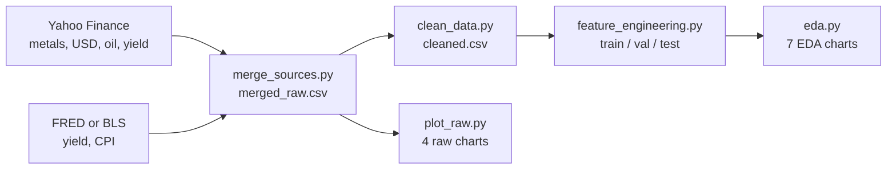

<div align="center">

# 📈 ProcurePulse

### Know when to buy. Know what to pay.

*AI-assisted metal procurement: forecast COMEX metal prices, then tell a buyer whether a supplier's quote means **Buy**, **Hold** or **Negotiate**.*


[The problem](#-the-problem) •
[Team](#-team) •
[Data](#-data-sources) •
[Quick start](#-quick-start) •
[Pipeline](#-how-the-pipeline-works) •
[Report](#-report)

</div>

---

## 💡 The problem

Small and medium-sized businesses that buy metals, such as **jewellers, electronics assemblers and metal fabricators**, pay whatever the market price is on the day they buy. They also have no easy way to tell whether a supplier's quote is fair.

And prices move a lot. In our own data:

| | |
|---|---|
| 🥇 **Gold** | rose from about **$1,050/oz** (2015) to over **$5,000/oz** (2026) |
| 📉 **Worst single day** | **−10.8%** for gold, **−22.3%** for copper, **−31.3%** for silver |
| 🛢️ **Oil** | WTI futures closed at **−$37.63** on 20 April 2020 |

Large firms have analysts and hedging desks for this. Smaller firms usually rely on gut feeling.

**ProcurePulse closes that gap.** It forecasts metal prices with a *prediction interval* (a range the price is expected to stay within), compares the supplier's quote with that range, and gives a one-word answer:

| Recommendation | Meaning |
|:---:|---|
| ✅ **Buy** | The quote is good compared with the expected price |
| ⏳ **Hold** | Prices are expected to fall, so waiting is likely cheaper |
| 🤝 **Negotiate** | The quote is high compared with the forecast range |

> 📄 The full problem statement, target audience and AI justification are in **Section 2** of the report.

---

## 👥 Team

| Member | Responsibilities |
|---|---|
| **Hassan** (lead) | Problem definition (Phase 1), data collection scripts, raw-data charts, report introduction, data collection and conclusion |
| **Sharjeel** | Data cleaning, feature engineering, exploratory data analysis (EDA), report sections on cleaning and features/EDA |
| **Zunaira Tahir** | Fixing errors in the code and report, README, final report compilation and submission |

---

## 🧾 Data sources

All data is **public and free**, collected daily from **1 January 2010** up to the day the scripts are run.

| Column | What it is | Source (ID) | Frequency |
|---|---|---|:---:|
| `gold` | COMEX gold futures, USD/oz | Yahoo Finance (`GC=F`) | Daily |
| `silver` | COMEX silver futures, USD/oz | Yahoo Finance (`SI=F`) | Daily |
| `copper` | COMEX copper futures, USD/lb | Yahoo Finance (`HG=F`) | Daily |
| `platinum` | NYMEX platinum futures, USD/oz | Yahoo Finance (`PL=F`) | Daily |
| `dxy` | US Dollar Index | Yahoo Finance (`DX-Y.NYB`) | Daily |
| `wti` | WTI crude oil futures, USD/barrel | Yahoo Finance (`CL=F`) | Daily |
| `us10y` | 10-year US Treasury yield, % | FRED (`DGS10`) · backup: Yahoo (`^TNX`) | Daily |
| `cpi` | US Consumer Price Index (seasonally adjusted) | FRED (`CPIAUCSL`) · backup: BLS (`CUSR0000SA0`) | Monthly |

> 🔁 **Automatic backups.** `fetch_external.py` tries FRED first. If FRED is unreachable (it blocks some networks), the script switches to the backup source on its own and records the switch in the log.

<details>
<summary><b>Why these external signals?</b></summary>

<br>

- **US Dollar Index:** metals are priced in dollars, so a stronger dollar tends to push their prices down.
- **10-year Treasury yield:** gold pays no interest, so higher interest rates make holding gold less attractive.
- **WTI crude oil:** feeds into mining and transport costs, and into inflation.
- **CPI:** gold is often bought as a hedge against inflation, which the CPI measures.

</details>

---

## 🚀 Quick start

> Requires **Python 3.10+** and **Git**.

**1. Get the code**

```bash
git clone https://github.com/hassan3073/procurepulse.git
cd procurepulse
```

**2. Create an environment and install the packages**

```bash
python -m venv .venv

# Windows (PowerShell)
.\.venv\Scripts\Activate.ps1
# macOS / Linux
source .venv/bin/activate

pip install -r requirements.txt
```

> 💡 If PowerShell refuses to run the activation script, skip it and call Python directly, e.g. `.\.venv\Scripts\python data_scripts/fetch_metals.py`.

**3. Run the pipeline** from the repository root, **in this order**:

```bash
python data_scripts/fetch_metals.py          # 1  metal prices        -> data/raw/<metal>.csv
python data_scripts/fetch_external.py        # 2  external signals    -> data/raw/<signal>.csv
python data_scripts/merge_sources.py         # 3  merge               -> data/raw/merged_raw.csv
python data_scripts/plot_raw.py              # 4  raw-data charts     -> report/figures/raw/
python data_scripts/clean_data.py            # 5  cleaning            -> data/processed/cleaned.csv
python data_scripts/feature_engineering.py   # 6  features & splits   -> data/processed/features_*.csv
python data_scripts/eda.py                   # 7  EDA charts          -> report/figures/eda/
```

⏱️ The whole run takes a few minutes. Steps 1–3 need internet; steps 4–7 work offline. If FRED is blocked, step 2 pauses for about two minutes per series before switching to its backup source. That's expected.

---

## 🔧 How the pipeline works



### 📊 What each step produces (October 2026 run)

| Step | Output | Result |
|---|---|---|
| **Collect & merge** | `data/raw/merged_raw.csv` | 4,300 rows × 8 columns, gaps left empty on purpose |
| **Clean** | `data/processed/cleaned.csv` | 4,225 trading days, no missing values, 129 extreme days flagged |
| **Features** | `features_train.csv` · `features_val.csv` · `features_test.csv` · `scaler.joblib` | Train 2010–2021 (2,988) · Validation 2022–2023 (502) · Test 2024–2026 (700) |
| **Charts** | `report/figures/raw/` · `report/figures/eda/` | 4 raw-data charts + 7 EDA charts |
| **Logs** | `data_scripts/logs/` | Row counts, date ranges and missing values for every step |

<details>
<summary><b>🧹 Cleaning in detail</b></summary>

<br>

| Issue | How it is handled |
|---|---|
| Duplicate dates | Removed, keeping the last value |
| CPI is monthly | Forward-filled to every trading day |
| Weekends and holidays | Rows where every metal is missing are dropped |
| Short gaps (≤ 3 days) | Time-based interpolation |
| Negative WTI price (−$37.63) | Replaced by interpolation, since a negative price breaks percentage returns |
| Extreme daily moves | Flagged with a 3 × IQR rule on daily returns, **not deleted** |

</details>

<details>
<summary><b>🧠 Features and targets</b></summary>

<br>

- **Returns:** daily % change for every price, change in points for the yield, log return for gold
- **Lags:** gold 1, 5 and 20 trading days ago
- **Rolling windows:** 7- and 30-day moving averages, 30-day volatility
- **Calendar:** month and weekday encoded as sine/cosine, so December sits next to January
- **Targets:** gold price 5 trading days ahead, and whether it goes up (`direction_5d`)

</details>

> 🛡️ **No data leakage.** The data is split **by date**, never shuffled. Outlier caps and the `StandardScaler` are learned from the **training period only**.

---

## 📁 Repository structure

```text
procurepulse/
├── data/                      ← created by the scripts, never uploaded to GitHub
│   ├── raw/                   ← downloaded CSVs + merged_raw.csv
│   └── processed/             ← cleaned.csv, features_*.csv, scaler.joblib
├── data_scripts/              ← all Phase 2 code
│   ├── config.py              ← shared paths, tickers and the data contract
│   ├── fetch_metals.py        ← 1  metal futures
│   ├── fetch_external.py      ← 2  USD index, oil, yield, CPI
│   ├── merge_sources.py       ← 3  merge into merged_raw.csv
│   ├── plot_raw.py            ← 4  raw-data charts
│   ├── clean_data.py          ← 5  cleaning
│   ├── feature_engineering.py ← 6  features, split, capping, scaling
│   ├── eda.py                 ← 7  EDA charts
│   └── logs/                  ← run logs (copies in report/evidence/)
├── report/                    ← LaTeX report
│   ├── main.tex
│   ├── sections/              ← one .tex file per section
│   ├── figures/               ← raw/ and eda/ charts
│   ├── evidence/              ← collection screenshot and log copies
│   └── refs_a.bib, refs_b.bib
├── requirements.txt
└── README.md
```

> 📝 The assignment guide calls the code folder `/data scripts`. We use `data_scripts/` (no space) so paths work on every operating system.

---

## 📄 Report

The technical report is in [`report/`](report/), written in LaTeX.

| Option | How |
|---|---|
| **Overleaf** | Zip the contents of `report/` → *New Project* → *Existing project (.zip)* → *Recompile* |
| **Locally** | From `report/`: `pdflatex main` → `bibtex main` → `pdflatex main` → `pdflatex main` |

> ⚠️ Don't link Overleaf to this repository. The `.tex` files on GitHub are the master copy.

---

## 📌 Notes

- **Raw data is not on GitHub** (see `.gitignore`). Run the scripts to recreate it.
- **Prices are continuous front-month futures**, which can jump when one contract rolls over to the next. Such jumps are among the extreme days flagged during cleaning.
- **Results depend on the run date**, because the scripts always download data up to today.

<div align="center">

<br>

*Built for the AI Project course, Deliverable 1: Problem Definition & Data Foundations.*

</div>
