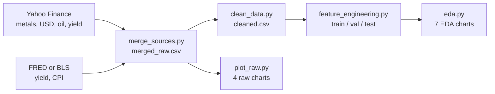
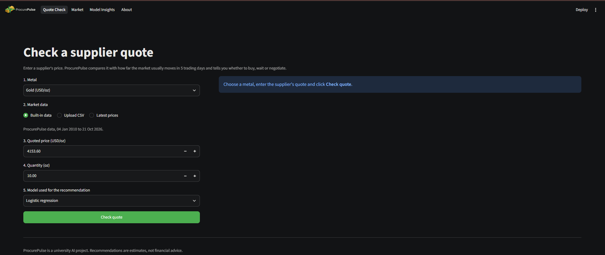

<div align="center">

# 📈 ProcurePulse

### Know when to buy. Know what to pay.

*AI-assisted metal procurement: forecast COMEX metal prices, then tell a buyer whether a supplier's quote means **Buy**, **Hold** or **Negotiate**.*


[The problem](#-the-problem) •
[Team](#-team) •
[Data](#-data-sources) •
[Quick start](#-quick-start) •
[Pipeline](#-how-the-pipeline-works) •
[Models](#-deliverable-2-models) •
[Results](#-results) •
[App](#-deliverable-3-application) •
[Recommendations](#-buy--hold--negotiate) •
[Weights](#-model-weights) •
[Report](#-report)

</div>

---

## 💡 The problem

Small and medium-sized businesses that buy metals, such as **jewellers, electronics assemblers and metal fabricators**, pay whatever the market price is on the day they buy. They also have no easy way to tell whether a supplier's quote is fair.

And prices move a lot. In our own data:

| | |
|---|---|
| 🥇 **Gold** | rose from about **$1,050/oz** (2015) to over **$5,000/oz** (2026) |
| 📉 **Worst single day** | **−10.8%** for gold, **−22.3%** for copper, **−31.3%** for silver |
| 🛢️ **Oil** | WTI futures closed at **−$37.63** on 20 April 2020 |

Large firms have analysts and hedging desks for this. Smaller firms usually rely on gut feeling.

**ProcurePulse closes that gap.** It forecasts metal prices with a *prediction interval* (a range the price is expected to stay within), compares the supplier's quote with that range, and gives a one-word answer:

| Recommendation | Meaning |
|:---:|---|
| ✅ **Buy** | The quote is good compared with the expected price |
| ⏳ **Hold** | Prices are expected to fall, so waiting is likely cheaper |
| 🤝 **Negotiate** | The quote is high compared with the forecast range |

> 📄 The full problem statement, target audience and AI justification are in **Section 2** of the report.

---

## 👥 Team

| Member | Deliverable 1 | Deliverable 2 | Deliverable 3 |
|---|---|---|---|
| **Hassan Ashraf 24L-3073** (lead) | Problem definition (Phase 1), data collection scripts, raw-data charts, report introduction, data collection and conclusion | Shared setup, scikit-learn models and tuning, evaluation module, `main.py` steps 8–11, report sections on classical models, evaluation, architecture and contributions, README | Price range and Buy/Hold/Negotiate rule, app setup, theme and logo, inference pipeline, Quote Check page, Latest prices download, report abstract, recommendations, introduction, conclusion and contributions, metrics chart fix, app screenshots, README |
| **Sharjeel Shahid 24L-3055** | Data cleaning, feature engineering, exploratory data analysis (EDA), report sections on cleaning and features/EDA | PyTorch LSTM (dataset, model, training, tuning, curves), error analysis and bias check, report sections on the LSTM and the Bias Check | LSTM inference, Market page, Model Insights page, sample predictions figure, About page, report section on the application |
| **Zunaira Tahir 24L-3038** | Fixing errors in the code and report, README, final report compilation and submission | – | – |

---

## 🧾 Data sources

All data is **public and free**, collected daily from **1 January 2010** up to the day the scripts are run.

| Column | What it is | Source (ID) | Frequency |
|---|---|---|:---:|
| `gold` | COMEX gold futures, USD/oz | Yahoo Finance (`GC=F`) | Daily |
| `silver` | COMEX silver futures, USD/oz | Yahoo Finance (`SI=F`) | Daily |
| `copper` | COMEX copper futures, USD/lb | Yahoo Finance (`HG=F`) | Daily |
| `platinum` | NYMEX platinum futures, USD/oz | Yahoo Finance (`PL=F`) | Daily |
| `dxy` | US Dollar Index | Yahoo Finance (`DX-Y.NYB`) | Daily |
| `wti` | WTI crude oil futures, USD/barrel | Yahoo Finance (`CL=F`) | Daily |
| `us10y` | 10-year US Treasury yield, % | FRED (`DGS10`) · backup: Yahoo (`^TNX`) | Daily |
| `cpi` | US Consumer Price Index (seasonally adjusted) | FRED (`CPIAUCSL`) · backup: BLS (`CUSR0000SA0`) | Monthly |

> 🔁 **Automatic backups.** `fetch_external.py` tries FRED first. If FRED is unreachable (it blocks some networks), the script switches to the backup source on its own and records the switch in the log.

<details>
<summary><b>Why these external signals?</b></summary>

<br>

- **US Dollar Index:** metals are priced in dollars, so a stronger dollar tends to push their prices down.
- **10-year Treasury yield:** gold pays no interest, so higher interest rates make holding gold less attractive.
- **WTI crude oil:** feeds into mining and transport costs, and into inflation.
- **CPI:** gold is often bought as a hedge against inflation, which the CPI measures.

</details>

---

## 🚀 Quick start

> Requires **Python 3.10+** and **Git**.

**1. Get the code**

```bash
git clone https://github.com/hassan3073/procurepulse.git
cd procurepulse
```

**2. Create an environment and install the packages**

```bash
python -m venv .venv

# Windows (PowerShell)
.\.venv\Scripts\Activate.ps1
# macOS / Linux
source .venv/bin/activate

pip install -r requirements.txt
```

> 💡 If PowerShell refuses to run the activation script, skip it and call Python directly, e.g. `.\.venv\Scripts\python main.py`.

**3. Run the whole pipeline with one command** from the repository root:

```bash
python main.py
```

`main.py` runs the 11 steps below in order, shows which step it is on and how long each took, and stops at the first error, telling you where to resume.

| Command | What it does |
|---|---|
| `python main.py` | Run all 11 steps: data (1–7), training (8–9), evaluation (10), error analysis (11) |
| `python main.py --skip-download` | Reuse the data already downloaded and start at step 4 |
| `python main.py --from 8` | Modelling only: train, evaluate and analyse on the existing feature files |
| `python main.py --list` | Show the steps without running anything |

<details>
<summary><b>Or run the steps one by one</b></summary>

<br>

```bash
python data_scripts/fetch_metals.py          # 1  metal prices        -> data/raw/<metal>.csv
python data_scripts/fetch_external.py        # 2  external signals    -> data/raw/<signal>.csv
python data_scripts/merge_sources.py         # 3  merge               -> data/raw/merged_raw.csv
python data_scripts/plot_raw.py              # 4  raw-data charts     -> report/figures/raw/
python data_scripts/clean_data.py            # 5  cleaning            -> data/processed/cleaned.csv
python data_scripts/feature_engineering.py   # 6  features & splits   -> data/processed/features_*.csv
python data_scripts/eda.py                   # 7  EDA charts          -> report/figures/eda/
python -m src.classical.train_classical      # 8  scikit-learn models -> results/predictions/, results/tuning/
python -m src.deep.train_lstm                # 9  LSTM                -> results/predictions/lstm.csv, results/history/
python -m src.evaluation.evaluate            # 10 evaluation          -> results/metrics/, results/tables/
python -m src.analysis.error_analysis        # 11 error analysis      -> results/analysis/
```

</details>

⏱️ Steps 1–7 take a few minutes; steps 1–3 need internet. Step 8 (grid search) takes about 3–8 minutes and step 9 (LSTM on CPU) a few minutes more. If FRED is blocked, step 2 pauses for about two minutes per series before switching to its backup source. That's expected.

```bash
python -m pytest tests -q     # run the test suite (no data needed)
```

---

## 🔧 How the pipeline works



### 📊 What each step produces (October 2026 run)

| Step | Output | Result |
|---|---|---|
| **Collect & merge** | `data/raw/merged_raw.csv` | 4,300 rows × 8 columns, gaps left empty on purpose |
| **Clean** | `data/processed/cleaned.csv` | 4,225 trading days, no missing values, 129 extreme days flagged |
| **Features** | `features_train.csv` · `features_val.csv` · `features_test.csv` · `scaler.joblib` | Train 2010–2021 (2,988) · Validation 2022–2023 (502) · Test 2024–2026 (700) |
| **Charts** | `report/figures/raw/` · `report/figures/eda/` | 4 raw-data charts + 7 EDA charts |
| **Logs** | `data_scripts/logs/` | Row counts, date ranges and missing values for every step |

<details>
<summary><b>🧹 Cleaning in detail</b></summary>

<br>

| Issue | How it is handled |
|---|---|
| Duplicate dates | Removed, keeping the last value |
| CPI is monthly | Forward-filled to every trading day |
| Weekends and holidays | Rows where every metal is missing are dropped |
| Short gaps (≤ 3 days) | Time-based interpolation |
| Negative WTI price (−$37.63) | Replaced by interpolation, since a negative price breaks percentage returns |
| Extreme daily moves | Flagged with a 3 × IQR rule on daily returns, **not deleted** |

</details>

<details>
<summary><b>🧠 Features and targets</b></summary>

<br>

- **Returns:** daily % change for every price, change in points for the yield, log return for gold
- **Lags:** gold 1, 5 and 20 trading days ago
- **Rolling windows:** 7- and 30-day moving averages, 30-day volatility
- **Calendar:** month and weekday encoded as sine/cosine, so December sits next to January
- **Targets:** gold price 5 trading days ahead, and whether it goes up (`direction_5d`)

</details>

> 🛡️ **No data leakage.** The data is split **by date**, never shuffled. Outlier caps and the `StandardScaler` are learned from the **training period only**.

---

## 🤖 Deliverable 2: Models

**Task:** for each trading day, predict whether the gold price will be **higher five trading days later** (`direction_5d` = 1 for "up"). Every model reads the same feature files and writes its predictions in one shared format, `results/predictions/<model>.csv`.

| Model | Framework | What it learns | Code |
|---|---|---|---|
| Majority baseline | scikit-learn | Always predicts the most common class ("up"); the bar to beat | `src/classical/` |
| Logistic regression | scikit-learn | One weight per feature, linear decision boundary | `src/classical/` |
| Random forest | scikit-learn | Average of many decision trees | `src/classical/` |
| Hist. gradient boosting | scikit-learn | Shallow trees that correct each other's errors | `src/classical/` |
| LSTM | PyTorch | Reads the last 60 days as a sequence: 2-layer LSTM → dense → probability | `src/deep/` |

<details>
<summary><b>🧪 How the models are validated</b></summary>

<br>

- **Chronological split** from Deliverable 1: train 2010–2021, validation 2022–2023, test 2024–2026. Never shuffled.
- **Walk-forward cross-validation** (`TimeSeriesSplit`, 5 folds, 5-day gap) on the training years to tune the scikit-learn models, scored by AUC-ROC.
- **Purging:** the last 5 rows of train and validation are dropped when fitting, because their labels look into the next period.
- **Validation split** chooses the feature set (all 27 features vs 14 stationary ones) and stops LSTM training early; the **test split** is used once.
- **Metrics:** accuracy, precision, recall, F1 and AUC-ROC. Accuracy alone misleads, because 61% of test weeks went up.

</details>

---

## 📊 Results

Test set: 2024 to October 2026, 701 trading days, 60.9% "up". Full table: [`results/tables/model_comparison.csv`](results/tables/model_comparison.csv).

| Model | Accuracy | Precision | Recall | F1 | AUC-ROC (test) | AUC-ROC (validation) |
|---|:---:|:---:|:---:|:---:|:---:|:---:|
| Majority baseline | 0.609 | 0.609 | 1.000 | 0.757 | 0.500 | 0.500 |
| Logistic regression | 0.498 | **0.696** | 0.311 | 0.430 | 0.569 | 0.530 |
| Random forest | 0.391 | 0.000 | 0.000 | 0.000 | 0.551 | 0.538 |
| Hist. gradient boosting | 0.391 | 0.000 | 0.000 | 0.000 | **0.599** | 0.524 |
| LSTM | 0.522 | 0.643 | 0.485 | **0.553** | 0.538 | **0.594** |

**What this means**

- 📉 **The signal is small.** The best test AUC is 0.60; gold's 5-day direction is only slightly predictable from these features.
- ✅ **Logistic regression** gives the most reliable "up" calls (70% precision, above the 61% base rate).
- ⚖️ **The LSTM** gives the most balanced predictions (best F1 of the learned models) and does not collapse to one class.
- ⚠️ **The tree models predict "down" on every test day.** They rely on price levels, and gold in 2024–2026 traded far above anything in the training years; trees cannot extrapolate. The error analysis and **Bias Check** (`results/analysis/`, report) study this in detail.

---

## 🖥️ Deliverable 3: Application

A local **Streamlit** app turns the saved models into a tool a buyer can use. It runs on your own computer (no hosting) and computes every result when you click, from the saved weights. **It never retrains the models.**

```bash
python -m streamlit run app/streamlit_app.py
```

The app opens in your browser at `http://localhost:8501`. It needs the weights in `models/` (see [Model weights](#-model-weights)) and the processed data in `data/processed/` (see [Quick start](#-quick-start)).

| Page | What it does |
|---|---|
| **Quote Check** | Enter a metal, a supplier's price and a quantity. Get **Buy**, **Hold** or **Negotiate**, the reasons, the fair price, the walk-away price, the cost compared with the market and, for gold, each model's chance of a rise |
| **Market** | Price history for every metal and signal, 30-day change and volatility, outlier days, gold against the US dollar and oil |
| **Model Insights** | Test results of all 5 models, ROC curves, confusion matrices, LSTM training curves, error analysis, Bias Check and sample predictions |
| **About** | What ProcurePulse is, the data, the models, the limitations, the team, Terms of Service and Privacy Policy |

**Market data options on Quote Check**

| Option | What it uses |
|---|---|
| **Built-in data** | The project's cleaned prices (in the submitted data: 4 Jan 2010 to 21 Oct 2026) |
| **Upload CSV** | Your own file with the columns `date, gold, silver, copper, platinum, dxy, wti, us10y, cpi` and at least 100 trading days. A template can be downloaded on the page |
| **Latest prices** | Downloads about one year of prices from Yahoo Finance and the US Bureau of Labor Statistics when you check a quote. Needs internet; the prices are kept in memory only |

Uploaded and downloaded prices go through the same cleaning and feature steps as the training data.

<div align="center">

</div>

---

## ⚖️ Buy / Hold / Negotiate

The models predict only the **direction** of gold. To judge a quote, ProcurePulse also needs to know how far a price usually moves. For each metal it takes every **5-day price change in the training years (2010 to 2021)** and uses the 10th, 50th and 90th percentiles to build an expected range around the latest price:

| Metal | Low (10th) | Fair price (50th) | Walk-away price (90th) |
|---|:---:|:---:|:---:|
| Gold | −2.5% | +0.2% | +2.7% |
| Silver | −4.4% | +0.1% | +4.8% |
| Copper | −3.5% | +0.1% | +3.7% |
| Platinum | −3.8% | −0.1% | +3.9% |

The models were trained for gold only, so **gold uses the AI model and the range**, while **silver, copper and platinum use the range only** (labelled *Price range only* in the app).

| Action | Gold (AI model + range) | Silver, copper, platinum (range only) |
|:---:|---|---|
| ✅ **Buy** | Quote below the low, or inside the range and the model gives a rise a chance of 50% or more | Quote at or below the fair price |
| ⏳ **Hold** | Quote inside the range and the model expects a fall | Quote between the fair price and the walk-away price |
| 🤝 **Negotiate** | Quote above the walk-away price | Quote above the walk-away price |

The default gold model is **logistic regression**, which gave the most reliable "up" calls on the test years. Full details, a worked example and the limitations are in **Section 10** of the report.

---

## 💾 Model weights

Trained weights are **not stored in Git** (`models/` is git-ignored). All of them are in one shared folder:

### 📂 [ProcurePulse Weights on Google Drive](https://drive.google.com/drive/folders/1f7wTbil1X0m18IeWe4aO0GA4EqdAEvhi?usp=sharing)

The folder has the same layout as the repository, so copy each subfolder into `models/`:

| Drive folder | Files | Model | Put them in |
|---|---|---|---|
| `models/classical/` | `majority.joblib`, `logreg.joblib`, `random_forest.joblib`, `hist_gb.joblib` | scikit-learn models | `models/classical/` |
| `models/deep/` | `lstm_best.pt`, `lstm_config.json` | LSTM | `models/deep/` |

You don't need them to reproduce the results: `python main.py --from 8` retrains every model from the feature files.

---

## 📁 Repository structure

```text
procurepulse/
├── data/                      ← created by the scripts, never uploaded to GitHub
│   ├── raw/                   ← downloaded CSVs + merged_raw.csv
│   └── processed/             ← cleaned.csv, features_*.csv, scaler.joblib
├── data_scripts/              ← all Phase 2 code
│   ├── config.py              ← shared paths, tickers and the data contract
│   ├── fetch_metals.py        ← 1  metal futures
│   ├── fetch_external.py      ← 2  USD index, oil, yield, CPI
│   ├── merge_sources.py       ← 3  merge into merged_raw.csv
│   ├── plot_raw.py            ← 4  raw-data charts
│   ├── clean_data.py          ← 5  cleaning
│   ├── feature_engineering.py ← 6  features, split, capping, scaling
│   ├── eda.py                 ← 7  EDA charts
│   └── logs/                  ← run logs (copies in report/evidence/)
├── src/                       ← Deliverable 2 code (run with python -m from the repo root)
│   ├── classical/             ← data loader, 4 scikit-learn models, tuning and training
│   ├── deep/                  ← LSTM dataset, model, training, tuning, curves
│   ├── evaluation/            ← metrics, comparison table, ROC and confusion charts
│   └── analysis/              ← error analysis by market regime, Bias Check
├── results/                   ← small result files, committed
│   ├── predictions/           ← <model>.csv for all 5 models (the shared format)
│   ├── tuning/                ← every hyperparameter configuration tried
│   ├── history/               ← LSTM loss and accuracy per epoch
│   ├── metrics/, tables/      ← metrics.json, model_comparison.csv
│   └── analysis/              ← segment_metrics.csv, bias_check.csv
├── models/                    ← trained weights, never uploaded to GitHub (see Model weights)
├── tests/                     ← pytest suite (python -m pytest tests -q)
├── report/                    ← LaTeX report
│   ├── main.tex
│   ├── sections/              ← one .tex file per section
│   ├── figures/               ← raw/, eda/, classical/, deep/, evaluation/, analysis/, architecture/
│   ├── evidence/              ← collection screenshot and log copies
│   ├── refs_a.bib, refs_b.bib
│   └── ProcurePulse_Deliverable1.pdf, ProcurePulse_Deliverable2.pdf
├── main.py                    ← run the whole pipeline with one command
├── requirements.txt
└── README.md
```

> 📝 The assignment guide calls the code folder `/data scripts`. We use `data_scripts/` (no space) so paths work on every operating system.

---

## 📄 Report

The technical report is in [`report/`](report/), written in LaTeX.

| Option | How |
|---|---|
| **Overleaf** | Zip the contents of `report/` → *New Project* → *Existing project (.zip)* → *Recompile* |
| **Locally** | From `report/`: `pdflatex main` → `bibtex main` → `pdflatex main` → `pdflatex main` |

> ⚠️ Don't link Overleaf to this repository. The `.tex` files on GitHub are the master copy.

---

## 📌 Notes

- **Raw data is not on GitHub** (see `.gitignore`). Run the scripts to recreate it.
- **Prices are continuous front-month futures**, which can jump when one contract rolls over to the next. Such jumps are among the extreme days flagged during cleaning.
- **Results depend on the run date**, because the scripts always download data up to today. The Deliverable 2 results above were produced on one shared data download (test period ending 14 October 2026), so all five models are compared on exactly the same days.

<div align="center">

<br>

*Built for the AI Project course. Deliverable 1: Problem Definition & Data Foundations · Deliverable 2: Model Architecture & Empirical Evaluation.*

</div>